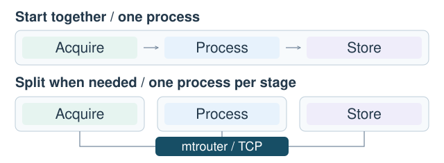
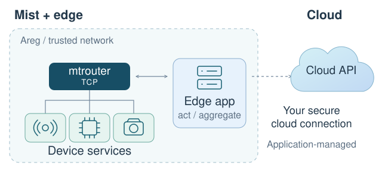

<a id="top"></a>

<div align="center">
  <a href="https://www.areg.tech">
    
  </a>
</div>

# Areg SDK - C++ IPC and distributed services

**Change the deployment. Keep the service code.**

Your processing stage needs its own process. Your device needs another client.
Neither should mean rewriting the communication.
Areg is a C++17 service framework: describe a typed interface, generate the communication
code, and implement your service logic. Keep the same provider and consumer implementations
across threads, processes and machines.

[](https://github.com/aregtech/areg-sdk/actions/workflows/cmake.yml)
[](https://codecov.io/gh/aregtech/areg-sdk)
[](https://github.com/aregtech/areg-sdk/releases)
[](./LICENSE.txt)

Linux · macOS · Windows · Embedded Linux

**[Run the example ↓](#quick-start)** · [Check the fit](#areg-vs-alternatives) · [Build with a coding agent](#agentic-coding)

<div align="center"><a href="./docs/wiki/03-helloservice-walkthrough.md"></a></div>

**One service implementation. Three deployments.**
[`03_helloservice`](./examples/03_helloservice/) builds every variant from the
[same provider and consumer sources](./examples/03_helloservice/common/src/).
The application models and build arrangement change; compiled model changes require a rebuild.
Cross-process communication uses `mtrouter` over plain TCP, for trusted networks.

## Quick start

Run the two-thread version first. Then separate the processes without editing the service implementations.

Requires Git, a C++17 compiler, CMake 3.20+ and Java 17+ for code generation.
No Java runtime or Python is needed by the resulting application.
[Install prerequisites](./docs/wiki/01e-build-environment.md).

Start in a directory without an existing `areg-sdk` folder. These commands build the example
from the current `master` branch, not a pinned release:

```sh
git clone https://github.com/aregtech/areg-sdk.git
cd areg-sdk
cmake -B build -DCMAKE_BUILD_TYPE=Release -DAREG_OUTPUT_LAYOUT=OFF -DAREG_EXAMPLES=ON
cmake --build build --config Release --target 03_twothreads -j4
```

<details open>
<summary>Run on Linux</summary>

```sh
./build/bin/03_twothreads.elf
```

</details>

<details>
<summary>Run on macOS</summary>

```sh
./build/bin/03_twothreads.mac
```

</details>

<details>
<summary>Run on Windows (PowerShell)</summary>

```powershell
.\build\bin\03_twothreads.exe
```

</details>

The provider prints the greeting and the example exits:

```text
'Hello Service!' from ServiceClient
```

### Now change the deployment

- **One thread:** [provider and consumer together](./examples/03_helloservice/onethread/src/main.cpp).
- **Two threads:** [one component per thread](./examples/03_helloservice/twothreads/src/main.cpp).
- **Two processes:** [provider model](./examples/03_helloservice/multiprocess/serviceproc/src/main.cpp),
  [consumer model](./examples/03_helloservice/multiprocess/clientproc/src/main.cpp) and `mtrouter`.

**[Run all three deployments →](./docs/wiki/03-helloservice-walkthrough.md)**
The walkthrough includes build/run commands, expected output and exactly which files differ.
The [shared interface](./examples/03_helloservice/services/HelloService.siml) is already `Public`;
it works locally too.

<a id="the-code-that-stays-the-same"></a>

<details>
<summary>See the C++ behind the greeting</summary>

Excerpts from the shared [consumer](./examples/03_helloservice/common/src/ClientComponent.cpp)
and [provider](./examples/03_helloservice/common/src/ServiceComponent.cpp).
Declarations, connection/error handling and this example's shutdown calls are omitted:

```cpp
// Consumer: after the service connects
request_hello_service(role_name());

// Provider: handle the request
void ServiceComponent::request_hello_service(const areg::String & client)
{
    std::cout << "'Hello Service!' from " << client << std::endl;
    response_hello_service(true);
}

// Consumer: handle the asynchronous response
void ClientComponent::response_hello_service(bool success)
{
    std::cout << (success ? "Succeeded" : "Failed") << " to output message." << std::endl;
}
```

No socket or remote address appears in these handlers. The deployment models above
decide where their components run.

</details>

Useful for your next C++ project? **Star Areg** to keep the example close at hand.

## Table of Contents

- [Run the example](#quick-start)
- [Find your use case](#use-cases)
- [Understand the architecture](#how-it-works)
- [Build with a coding agent](#agentic-coding)
- [Review performance and footprint](#performance)
- [Check the fit and tradeoffs](#areg-vs-alternatives)
- [Check project status](#project-status)
- [Start your own project](#getting-started)

## Use cases

Patterns to adapt to your application:

### Move the processing stage, not its implementation

Start an acquisition → processing → storage pipeline in one process. When processing
needs isolation or another machine, move its service component without rewriting its handlers.
The pattern fits imaging, industrial inspection and edge inference; capacity depends on
your hardware, network and processing workload.

<div align="center"><a href="./docs/img/areg-pipeline-deployments.svg"></a></div>

[Imaging pipelines](./docs/USECASES.md#scientific-and-industrial-imaging-pipelines) ·
[Edge inference](./docs/USECASES.md#edge-ai-and-inference-pipelines)

### Develop the client before the hardware exists

Implement the device's service interface in a simulated provider. Develop and exercise the
consumer, then connect it to a device-backed provider using the same interface and role name.
Keep the consumer's service calls; validate simulation fidelity separately.

<div align="center"><a href="./docs/img/areg-device-simulation.svg"></a></div>

[Simulation and hardware-in-the-loop](./docs/USECASES.md#simulation-and-hardware-in-the-loop-testing)

### Connect multiple applications to one backend

Let an operator UI, a monitoring application and a test tool consume the same backend service.
Use requests for commands and subscribed attributes for state updates, rather than designing
a separate protocol for each frontend.
[Multi-UI architectures](./docs/USECASES.md#multi-display-and-multi-ui-architectures).

<a id="give-a-device-a-typed-api"></a>
<a id="iot-mist-to-cloud--nebula"></a>
### Make decisions near devices; send results upstream

The **Nebula / Mist-to-Cloud** pattern: expose device capabilities as typed services,
coordinate them in an edge application, and send useful results to a cloud API.
Areg handles the trusted-network service communication; the application supplies
the cloud connection and its security.

<div align="center"><a href="./docs/img/areg-nebula.svg"></a></div>

[Device services](./docs/USECASES.md#device-as-a-service-driverless-hardware) ·
[Original Nebula illustration](./docs/img/mist-network.png)

More patterns: [incremental monolith decomposition](./docs/USECASES.md#incremental-decomposition-of-c-monoliths),
[industrial automation](./docs/USECASES.md#industrial-automation-and-robotics),
[digital twins](./docs/USECASES.md#digital-twins-and-real-time-monitoring),
[process-based extensions](./docs/USECASES.md#plugin-and-extension-architectures) and
[runtime configuration](./docs/USECASES.md#dynamic-configuration-propagation).

<div align="right"><a href="#table-of-contents">Contents</a> · <a href="#top">Back to top ↑</a></div>

## How it works

1. **Define the contract.** A `.siml` interface declares requests/responses, attributes
   (subscribed state) and broadcasts (events).
2. **Generate and implement.** CMake runs the generator. You implement the service behavior
   in classes derived from generated provider and consumer bases.
3. **Choose the deployment.** The application model declares threads, components and named
   dependencies. Loading it instantiates the components. Local communication uses event
   dispatch; cross-process communication uses `mtrouter`. Only `Public` interfaces can cross processes.

<a id="why-areg"></a>
**Less infrastructure to maintain:** generated proxies and serialization, name-based discovery
and reconnection, thread-owned dispatch and distributed logging.
Handlers run in their component's owning thread; state confined to that thread needs no
application locks. Keep handlers non-blocking and synchronize shared external state.

[Service interface designer](./docs/wiki/06e-lusan-service-interface.md) ·
[Code generator](./docs/wiki/06b-code-generator.md) ·
[Model-by-model walkthrough](./docs/wiki/03-helloservice-walkthrough.md#what-changes)

<a id="tools"></a>

<details>
<summary>See across processes with Lusan and distributed logging</summary>

`logcollector` gathers application logs; [Lusan](https://github.com/aregtech/areg-sdk-tools)
shows sources and messages together. Change logging priorities at runtime without a restart.

<div align="center"><a href="./docs/img/lusan-live-log-gen.png"></a></div>

This existing capture shows older example names, not the greeting above.
[Live-logging walkthrough](./docs/wiki/06f-lusan-live-logging.md) ·
[Interface designer](./docs/img/lusan-service-if-general.png).

</details>

<div align="right"><a href="#table-of-contents">Contents</a> · <a href="#top">Back to top ↑</a></div>

## Agentic coding

**Your agent writes service logic, not the plumbing.**

Areg's agentic layer pairs task-focused guidance with generators and executable checks:
**declare → generate → implement → verify**.

- **Focused context:** task routing and API lookup instead of a framework-wide search.
- **Less code to write:** generated components, models and a worksheet of business logic to implement.
- **A checked result:** contract checks, builds and scenarios exercise the application.

Start at [`AGENTS.md`](./AGENTS.md), or read the [workflow guide](./docs/wiki/09a-agentic-coding.md).
Python 3.10+ is needed for these tools, not for ordinary C++ development.

<details>
<summary>Measured workflow results, with their limits</summary>

In two October 2026 baselines, **28/28 Areg runs** passed their assigned hidden checks,
versus **12/15 gRPC runs**, with roughly **one-half to one-quarter as much hand-written C++**.
These are maintainer-authored tasks with unequal run counts, different tooling and some
different prompt requirements; runs could include fix cycles.
They measure those workflows, not general framework correctness.
Total cost varies by task and model; loading the guidance can require more input context.

[Sonnet baseline](./examples/ai-benchmark/baseline-2026-10-17.md) ·
[Terra baseline](./examples/ai-benchmark/baseline-2026-10-18.md) ·
[Reproducible tasks](./examples/ai-benchmark/) ·
[Share a run, passed or failed](https://github.com/aregtech/areg-sdk/discussions/800).

</details>

<div align="right"><a href="#table-of-contents">Contents</a> · <a href="#top">Back to top ↑</a></div>

## Performance

Published Linux TCP-loopback results on an i7-13700H with DDR4, using the framework stack,
not raw sockets:

<a id="latency-tcp-localhost-full-stack-204-byte-messages"></a>
<a id="throughput-tcp-localhost-11-measured-at-mtrouter"></a>

| Measurement | Result | Conditions |
|---|---|---|
| One-way latency, P50 | ~9.9 µs | 204-byte messages; pinned cores, bare TTY; July 2026 |
| Sustained data rate | ~6.0-6.5 GB/s | ~3 MB payloads; unpinned; 5-minute run |
| Sustained message rate | ~2.0M msg/s | ~0.5 KB payloads; unpinned; 5-minute run |

Latency covers serialization through receiver dispatch: sender → `mtrouter` → receiver.
Throughput is counted at `mtrouter`, not at the application handler. These are **separate
configurations**, not simultaneously achievable results or cross-machine bandwidth guarantees.

[Methodology and Linux/macOS/Windows results](./docs/wiki/08b-areg-sdk-performance-benchmarks.md) ·
[Raw latency CSV](./docs/wiki/areg-latency-benchmark-20260705.csv) ·
Reproduce: [`23_pubdatarate`](./examples/23_pubdatarate/) / [`30_publatency`](./examples/30_publatency/).

<a id="embedded-ready"></a>
### Embedded Linux footprint

Published ARMv7 Release measurements with GCC 15.2.0: a minimal static provider with logging
off has **288 KB of `text`** (code and read-only data), **485 KB whole binary**.
Shared `libareg.so` with logging on has **741 KB of `text`**, stored once for multiple services.
These are binary sizes, not RAM. Bare metal, RTOS and 16-bit targets are not supported today.
[Configurations, RAM measurements and limits](./docs/wiki/08e-embedded-ready.md).

<div align="right"><a href="#table-of-contents">Contents</a> · <a href="#top">Back to top ↑</a></div>

<a id="areg-vs-alternatives"></a>
## Is Areg a fit?

Choose by the architecture you need, not a universal framework ranking.

| Start by evaluating | When your deciding requirement is |
|---|---|
| Areg | An integrated C++ service/component model across threads, processes and trusted networks |
| [gRPC](https://grpc.io/docs/what-is-grpc/introduction/) | Cross-language RPC and the gRPC ecosystem |
| [DDS](https://www.dds-foundation.org/what-is-dds-3/) | DDS interoperability, typed publish/subscribe and its QoS model |
| [ZeroMQ](https://zeromq.org/) or [NNG](https://nng.nanomsg.org/) | Messaging primitives while retaining control of your service and lifecycle architecture |

**The commitment:** Areg supplies interfaces, generated base classes and a component lifecycle,
not just a transport library. Adapting existing code to service boundaries is application work.

**The boundary:** `mtrouter` currently uses plain TCP without built-in authentication or encryption.
Areg is not an internet-facing API gateway. Its thread watchdog does not restart crashed
processes or restore application state.

<div align="right"><a href="#table-of-contents">Contents</a> · <a href="#top">Back to top ↑</a></div>

## Project status

The current named release is [`v2.0.0-rc1`](https://github.com/aregtech/areg-sdk/releases/tag/v2.0.0-rc1),
the first 2.0 release candidate. The example above evaluates `master`.
Supported: 2.0.0-rc1 and newer, and `master`; 1.5.0 and earlier use a different, unsupported API.

| Evidence | Reports |
|---|---|
| Builds | [](https://github.com/aregtech/areg-sdk/actions/workflows/cmake.yml) [](https://github.com/aregtech/areg-sdk/actions/workflows/msbuild.yml) [](https://github.com/aregtech/areg-sdk/actions/workflows/platforms.yml) |
| Analysis | [](https://github.com/aregtech/areg-sdk/actions/workflows/codeql-analysis.yml) [](https://github.com/aregtech/areg-sdk/actions/workflows/sanitizers.yml) [](https://github.com/aregtech/areg-sdk/actions/workflows/agent-docs.yml) |

The coverage badge at the top links to its report; coverage is not a guarantee of correctness.

### Roadmap

Next: the 2.0.0 release and vcpkg port, followed by RTOS support starting with Zephyr.
Shared-memory transport and optional TLS are planned, not shipped.
[Discuss priorities](https://github.com/aregtech/areg-sdk/discussions).

### License

[Apache License 2.0](./LICENSE.txt), permitting open-source and commercial use.
Optional commercial licensing, training and dedicated support: **info[at]areg[dot]tech**.
Commercial support is not required for commercial use of the Apache-licensed SDK.

<div align="right"><a href="#table-of-contents">Contents</a> · <a href="#top">Back to top ↑</a></div>

<a id="getting-started"></a>
<a id="ways-in"></a>
<a id="learning-path"></a>
<a id="documentation"></a>
## Start your own project

| Your next step | Start here |
|---|---|
| Create a new application | [Project setup](./docs/wiki/02a-quick-project-setup.md): local, IPC and publish/subscribe recipes |
| Add Areg to an existing project | [CMake integration](./docs/wiki/02b-cmake-integrate.md) |
| Work with a coding agent | [AGENTS.md](./AGENTS.md) |
| Explore further | [Examples](./examples/README.md) · [Wiki](./docs/wiki/README.md) · [HOWTO](./docs/HOWTO.md) |

### Community

[Ask a question or share a project](https://github.com/aregtech/areg-sdk/discussions) ·
[Report an issue](https://github.com/aregtech/areg-sdk/issues) ·
[Contribute](./CONTRIBUTING.md).
Reproductions, measurements on your hardware and documentation improvements are welcome.

<div align="right"><a href="#table-of-contents">Contents</a> · <a href="#top">Back to top ↑</a></div>

---

*Areg (Արեգ) – Old Armenian: the Sun.*
