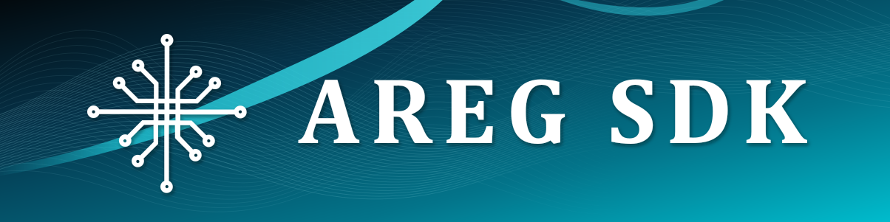
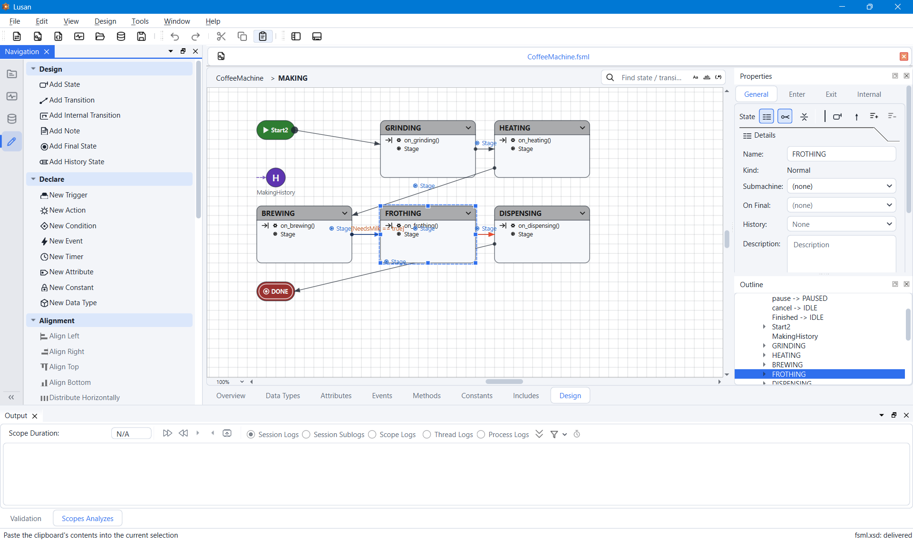
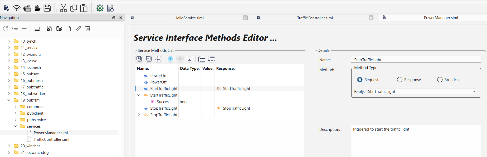

<div align="center">
  <a href="https://www.areg.tech">
    
  </a>

**Write a C++ service once. Run it in a thread, a process, or across the network.**

[](https://github.com/aregtech/areg-sdk/actions/workflows/cmake.yml)
[](https://github.com/aregtech/areg-sdk/releases)
[](./LICENSE.txt)
[](#getting-started)
[](#getting-started)

</div>

Most C++ projects don't fail on algorithms. They fail on **threads**, **IPC** and
**brittle integration code**. Areg takes that work off your hands.

Describe a service interface once. The code generator writes the proxies, the
serialization and the dispatch. The framework finds services by name and delivers every
call to the thread that owns the component. You write the logic: no socket code, no
startup-order handling, no locks around a component's own state.

| **~9.9 µs** | **~6.5 GB/s** | **288 KB** | **100%** |
|:---:|:---:|:---:|:---:|
| one-way latency, P50 | sustained throughput | code of a static service on ARMv7 | of apps built by AI agents pass every hidden test (gRPC: 80%) |

<sub>Latency and throughput: full service dispatch over TCP loopback, laptop Core i7, Linux.
[Performance](#performance) · [Embedded ready](#embedded-ready) · [Agentic coding](#agentic-coding)</sub>

For C++ on devices, desktops and servers in controlled private networks. Not for web
services or public internet endpoints.

**You write the logic.** The generated base classes deliver each call to the component's thread:

```cpp
// Consumer: send the request once the provider is connected, wherever it runs
request_hello_service(role_name());

// Provider thread or process: answer the request
void ServiceProvider::request_hello_service(const areg::String & client)
{
    GLOBAL_INFO("provider: hello, %s", client.as_string());
    response_hello_service(true);
}

// Consumer thread or process: receive the answer, asynchronously
void ServiceConsumer::response_hello_service(bool success)
{
    GLOBAL_INFO("consumer: %s", success ? "greeted" : "failed");
}
```

**You decide where it runs.** Here, two threads in one process:

```cpp
areg::Model model("HelloModel");
model.add_thread("ProviderThread")
     .add_component<ServiceProvider>("ServiceProvider")
     .add_supported_service(HelloService::ServiceName, HelloService::InterfaceVersion);
model.add_thread("ConsumerThread")
     .add_component<ServiceConsumer>("ServiceConsumer")
     .add_dependency_service("ServiceProvider");
```

**Move it, don't rewrite it.** [`03_helloservice`](./examples/03_helloservice/) builds the same
provider and consumer classes into one thread, two threads, and two processes connected
through `mtrouter`; only the model in `main.cpp` differs. To run the processes on different
machines, set the router address in `areg.init`.
Full working code: [one process](./docs/agent/recipes/01-local-single-process/) ·
[two processes](./docs/agent/recipes/02-ipc-two-processes/) ·
[model in plain C++](./docs/agent/recipes/10-runtime-model/) · [How it works](#how-it-works)

---

## Quick start[](#quick-start)

Your own project, built and running, with `myapp` as its name:

```bash
git clone https://github.com/aregtech/areg-sdk.git
sh areg-sdk/tools/setup-project.sh --name myapp --root myapp --mode local --sdk-root areg-sdk
cd myapp
cmake -B build && cmake --build build -j
./build/bin/myapp.elf                # myapp.mac on macOS
cat build/bin/logs/myapp_*.log
```

The program makes one round trip and exits. Its log holds the two lines of the code above:

```text
provider: hello, ServiceConsumer
consumer: greeted
```

**Now split it into two processes:** create the project with `--mode ipc` instead, build
it the same way, and `./run.sh` starts `mtrouter`, the provider and the consumer.
On Windows, use `areg-sdk\tools\setup-project.bat` with the same options, `myapp.exe` and `run.bat`.

Needs a C++17 compiler, CMake 3.20+ and Java 17+. Java runs the bundled code generator at
build time only; nothing Java reaches your binaries.

If Areg saves you work, a ⭐ helps other C++ developers find it.

---

## Table of Contents

- [Why Areg](#why-areg)
- [How it works](#how-it-works)
- [Performance](#performance)
- [Embedded ready](#embedded-ready)
- [Areg vs. alternatives](#areg-vs-alternatives)
- [Agentic coding](#agentic-coding)
- [Getting started](#getting-started)
- [Use cases](#use-cases)
- [Tools](#tools)
- [Project status](#project-status)
- [Roadmap](#roadmap)
- [Documentation](#documentation)
- [License](#license)
- [Community](#community)

---

## Why Areg[](#why-areg)

- **Less infrastructure code:** threading, IPC, service discovery and reconnection come
  from the framework and the generator instead of being rebuilt in every project.
  *([Estimated time savings](./docs/wiki/08d-areg-framework-rankings.md#10-development-time-savings-with-areg-sdk))*
- **No locks for a component's own state:** a component's calls run only in the thread
  that owns it; raw bytes route to that thread before any deserialization.
- **No startup-order logic:** services find each other by name, wherever they run, with
  no retry loops.
- **Recovery built in:** the watchdog restarts a stuck component thread; consumers are
  notified when a service disappears and reconnect when it returns.
- **Debug many processes as one:** `logcollector` gathers the logs of every thread,
  process and device; [Lusan](./docs/wiki/06f-lusan-live-logging.md) shows them live in
  one view and changes log priorities in the running applications, with no restart.
- **Test before hardware exists:** register a simulation under the same service name and
  the rest of the system never notices. No conditional compilation, no mock frameworks.

<div align="right"><kbd><a href="#table-of-contents">↑ Back to top ↑</a></kbd></div>

---

## How it works[](#how-it-works)

Components expose typed interfaces and talk through generated proxies. A consumer refers
to a service by **name**, not by address. The framework finds the provider in the same
thread, another process or another machine, and delivers every call to the thread that
owns the component.

The interface is a `.siml` document, designed in [Lusan](https://github.com/aregtech/areg-sdk-tools)
or edited as XML. This is the request of the example above:

```xml
<Method ID="2" Name="hello_service" MethodType="Request" Response="hello_service">
    <ParamList><Parameter ID="51" Name="client" DataType="String"/></ParamList>
</Method>
```

One CMake line generates the serialization, proxies, events and the provider and consumer
base classes, and links them:

```cmake
addServiceInterface(MyServiceLib ./services/MyService.siml)
```

| The framework handles | You write |
|---|---|
| thread lifecycle and message dispatch | the service interface |
| service discovery and registration | the logic in the provider and consumer classes |
| request, response and broadcast routing | the model: which component runs in which thread |
| watchdog, connection loss and reconnection | |

The provider and consumer classes are the same in every deployment. Across processes and
machines the interface is `Public`, and `mtrouter` carries the calls over TCP.
The model can be written in plain C++, as above, or with the `BEGIN_MODEL` macros the
examples use. Details: [Service interface guide](./docs/wiki/06e-lusan-service-interface.md) ·
[Code generator](./docs/wiki/06b-code-generator.md).

<div align="right"><kbd><a href="#table-of-contents">↑ Back to top ↑</a></kbd></div>

---

## Performance[](#performance)

Measured on **mobile-class consumer hardware** with the full stack active:
serialization, event dispatching and multithreading. These are not raw socket numbers.
Raw data is published: [latency dataset](./docs/wiki/areg-latency-benchmark-20260705.csv).

### Throughput: TCP `localhost`, 1:1, measured at `mtrouter`

| Platform       | CPU              | ~3 MB, GB/s              | ~0.5 KB, msg/s            |
|----------------|------------------|--------------------------|---------------------------|
| Linux Ubuntu   | i7-13700H (DDR4) | ~6.5 sust. / ~8.0 peak   | ~2.0M sust. / ~2.5M peak  |
| macOS native   | M3 Pro (LPDDR5)  | ~6.5 sust. / ~7.0 peak   | ~2.5M sust. / ~3.0M peak  |
| Windows 11     | i7-13700H (DDR4) | ~2.7                     | ~2.5M+                    |

<sub>Sustained = 5+ min run; peak = best short run.</sub>

### Latency: TCP `localhost`, full stack, 204-byte messages

From before serialization at the sender to after dispatch at the receiver. OWT = one-way
(2 hops); RTT = round trip through `mtrouter` (4 hops).
[Methodology](./docs/wiki/08b-areg-sdk-performance-benchmarks.md#21-measurement-environment-terminal-restart-protocol-and-absolute-floor).

| Platform       | CPU               | OWT Min    | OWT P50     | RTT Min     | RTT P50      |
|----------------|-------------------|------------|-------------|-------------|--------------|
| Linux Ubuntu   | i7-13700H (DDR4)  | **9.6 µs** | **~9.9 µs** | **19.1 µs** | **~19.5 µs** |
| macOS M3 Pro   | Apple M3 (LPDDR5) | 21.6 µs    | 31.4 µs     | 46.0 µs     | 62.5 µs      |
| Windows 11     | i7-13700H (DDR4)  | 32.5 µs    | 40.3 µs     | 64.0 µs     | 82.5 µs      |

Latency is payload-insensitive up to 4 KB: Min rises 1.0 µs across a 20× size increase.
For context only (third-party, 2021, different hardware): gRPC C++ sequential RTT
~116–167 µs over a Unix domain socket
([MPI-HD, F. Werner](https://www.mpi-hd.mpg.de/personalhomes/fwerner/research/2021/09/grpc-for-ipc/)).

📊 Measure your own hardware: [`23_pubdatarate`](./examples/23_pubdatarate/) (throughput) · [`30_publatency`](./examples/30_publatency/) (latency)
📈 [Full data and methodology](./docs/wiki/08b-areg-sdk-performance-benchmarks.md) · [vs ZMQ/NanoMsg/NNG](./docs/wiki/08c-areg-vs-hitachi-benchmark.md) · [Framework rankings](./docs/wiki/08d-areg-framework-rankings.md)

<div align="right"><kbd><a href="#table-of-contents">↑ Back to top ↑</a></kbd></div>

---

## Embedded ready[](#embedded-ready)

**Embedded Linux on a 32- or 64-bit CPU** -- ARM64, ARMv7, x86_64 and x86. If the target
runs Linux with sockets and pthreads, Areg runs on it: NXP i.MX, TI AM62/AM335x,
Rockchip RK3588, STM32MP1, Raspberry Pi, Intel Atom.

Framework code (`text`), GCC 15.2.0, Release, measured with
[`tools/intern/footprint.py`](./tools/intern/footprint.py) -- `x86_64` natively, ARM64 and
ARMv7 cross-compiled with the toolchain files the SDK ships:

| What a device stores | x86_64 | ARM64 | ARMv7 |
|---|---:|---:|---:|
| shared `libareg.so`, stored once for every service | 1.26 MB | 1.18 MB | **0.74 MB** |
| a self-contained service, static, logging off | 526 KB | 487 KB | **288 KB** |
| a service binary against the shared framework | 43 KB | 42 KB | 26 KB |
| `mtrouter` | 285 KB | 255 KB | 171 KB |

RAM on `x86_64`: a service holds **5.6 MB** resident, and each client connected to
`mtrouter` adds **~7 KB** ([RAM details](./docs/wiki/08e-embedded-ready.md#4-ram-what-a-process-holds)).

**Scope today:** embedded Linux only. Bare metal, RTOS and 16-bit targets are not
supported; Zephyr is planned after 2.0.0. ARM RAM is not published until it is measured
on ARM hardware.

📊 [What "embedded ready" means, tuning, and where the line is](./docs/wiki/08e-embedded-ready.md)

<div align="right"><kbd><a href="#table-of-contents">↑ Back to top ↑</a></kbd></div>

---

## Areg vs. alternatives[](#areg-vs-alternatives)

| | Areg SDK | gRPC | DDS |
|---|---|---|---|
| **Service model** | requests, attributes, broadcasts | RPC from `.proto` | typed topics |
| **Generated code** | proxies, base classes, dispatch | stubs, service bases | types, readers, writers |
| **Threading** | calls run in the owning thread | yours to synchronize | yours to synchronize |
| **Discovery** | by service name | DNS or xDS resolvers | built in |
| **Thread, process, network** | same classes; the model decides | same stubs; you pick the channel | same API |
| **Fault recovery** | watchdog restart, reconnect | retries, health checks | liveliness QoS |
| **Logging and tracing** | distributed logs, viewer | OpenTelemetry plugin | vendor tools |

ZeroMQ, NanoMsg and NNG are messaging transports rather than service frameworks: see the
[transport benchmark](./docs/wiki/08c-areg-vs-hitachi-benchmark.md).

<sub>Sources: gRPC [name resolution](https://grpc.io/docs/guides/custom-name-resolution/) ·
[in-process channel](https://grpc.github.io/grpc/cpp/classgrpc_1_1_server.html) ·
[retry](https://grpc.io/docs/guides/retry/) · [health checking](https://grpc.io/docs/guides/health-checking/) ·
[OpenTelemetry](https://grpc.io/docs/guides/opentelemetry-metrics/); DDS (OpenDDS)
[discovery](https://opendds.readthedocs.io/en/latest-release/devguide/introduction_to_dds.html#discovery-matching-and-association) ·
[QoS](https://opendds.readthedocs.io/en/latest-release/devguide/quality_of_service.html).</sub>

<div align="right"><kbd><a href="#table-of-contents">↑ Back to top ↑</a></kbd></div>

---

## Agentic coding[](#agentic-coding)

Coding agents barely know Areg from training, and they don't need to. [`AGENTS.md`](./AGENTS.md)
routes the agent to the one page its task needs. The agent declares services (`.siml`),
state machines (`.fsml`) and data types (`.dtml`); generators write the plumbing; a
checker catches invented API names; one command builds, runs and proves every program.

**Measured against gRPC**, which every model knows from training: same task, same agent,
same model, scored afterwards by hidden checks the agent never sees (peer loss, either
start order, no busy-wait, repeated runs).

| | Areg | gRPC |
|---|---|---|
| apps passing every hidden test | **100%** | 80% |
| C++ written by hand | **50-75% less** | reference |
| agent requests | **35% fewer** | reference |
| fix cycles per run | **over 80% fewer** | reference |
| price | **same**, with more requirements met | reference |

<sub>9 tasks, both current baselines merged: [Claude Code, Sonnet 5.5](./examples/ai-benchmark/baseline-2026-10-17.md)
and [Copilot CLI, GPT-5.6 Terra](./examples/ai-benchmark/baseline-2026-10-18.md); 28 of 28 Areg runs
and 12 of 15 gRPC runs passed. In the Terra runs the Areg tasks also had to print exact
output lines and declare a state machine.</sub>

**The guide is what makes it work.** On a plain checkout without it, the coffee-machine task
cost 5x as much and stopped with a program that did not work
([how to run it, and what it may cost](./examples/ai-benchmark/README.md#without-the-agent-layer)).

**No human drew this state machine.** An agent wrote the `.fsml` for the coffee-machine
task, and Lusan opened it as is: every state, trigger and transition valid, ready for the
generator. Only the box layout is rough.

<div align="center"></div>

**Try it** with your agent (Claude Code, Copilot CLI, Codex, Gemini, or any agent by hand)
on [one of twelve ready prompts](./examples/ai-benchmark/): coffee machine, ATM, elevator,
print/scan device, charge point and more. Add `--framework grpc` to run the same task on gRPC.

```bash
mkdir -p ~/runs && cd ~/runs
/path/to/areg-sdk/examples/ai-benchmark/run-benchmark.sh --task examples/ai-benchmark/prompt-elevator.md
```

**Share your run**, passed or failed, in
[Agentic coding: try it, break it, send me the run](https://github.com/aregtech/areg-sdk/discussions/800).
A failed run is the most useful one. Every result and the method:
[Agentic coding](./docs/wiki/09a-agentic-coding.md).

<div align="right"><kbd><a href="#table-of-contents">↑ Back to top ↑</a></kbd></div>

---

## Getting started[](#getting-started)

| Dependency   | Minimum                   | Notes |
|--------------|---------------------------|-------|
| C++ compiler | C++17                     | GCC, Clang, MSVC |
| CMake        | 3.20+                     | Visual Studio solution included |
| Java runtime | 17+                       | build time only: runs the bundled code generator |
| OS           | Windows 10+, Linux, macOS | Cygwin and MinGW included |
| Python 3     | *for agentic coding*      | runs the AI-agent tools; never needed to generate, build or run |

### Ways in

- **A new project:** the [Quick start](#quick-start) script. `--mode local` is one process
  with two threads, `--mode ipc` two processes through `mtrouter`, `--mode pubsub` adds
  attributes and broadcasts the consumer subscribes to. Without `--sdk-root`, the project
  fetches Areg from GitHub at configure time. [All options](./docs/wiki/02a-quick-project-setup.md).
- **An existing CMake project:** [CMake integration](./docs/wiki/02b-cmake-integrate.md).
- **The SDK and its examples:**

  ```bash
  git clone https://github.com/aregtech/areg-sdk.git
  cd areg-sdk
  cmake -B build
  cmake --build build -j
  ```

  Binaries land in `product/build/<compiler>/<os>-<bits>-<cpu>-release-shared/bin/`.
  More: [Build with CMake](./docs/wiki/01b-cmake-build.md) ·
  [Visual Studio](./docs/wiki/01c-msvc-build.md) · [WSL](./docs/wiki/01d-wsl-build.md).

### Learning path

**Start with three examples. Together they show the whole idea:**

1. **[01_minimalrpc](./examples/01_minimalrpc/)**: a provider and a consumer in two threads of one process.
2. **[02_minimalipc](./examples/02_minimalipc/)**: the same pair in two processes, through `mtrouter`.
3. **[03_helloservice](./examples/03_helloservice/)**: the same classes in one thread, two threads and two processes; only the model changes.

**Then continue with:**

- [16_pubmesh](./examples/16_pubmesh/): a mesh of local and public services discovering each other.
- [23_pubdatarate](./examples/23_pubdatarate/) and [30_publatency](./examples/30_publatency/): throughput and latency on your hardware.
- [33_tempalarm](./examples/33_tempalarm/) and [34_coffeemachine](./examples/34_coffeemachine/): **built by an AI agent**, with attributes, broadcasts and a generated state machine.
- [All examples](./examples/README.md)

<div align="right"><kbd><a href="#table-of-contents">↑ Back to top ↑</a></kbd></div>

---

## Use cases[](#use-cases)

| Domain | Why Areg |
|---|---|
| [Scientific and industrial imaging](./docs/USECASES.md#scientific-and-industrial-imaging-pipelines) | multi-megabyte frames at GB/s through full-stack IPC; pipeline stages move between threads, processes and machines |
| [Device-as-a-service](./docs/USECASES.md#device-as-a-service-driverless-hardware) | a device exposes its functions as a named service; hosts call it through a generated proxy, with no kernel driver |
| [Industrial automation and robotics](./docs/USECASES.md#industrial-automation-and-robotics) | watchdog restart, automatic re-registration and reconnection handle the faults that break hand-written IPC |
| [Edge AI and inference](./docs/USECASES.md#edge-ai-and-inference-pipelines) | acquisition, preprocessing and inference change topology without touching their classes |
| [Digital twins and monitoring](./docs/USECASES.md#digital-twins-and-real-time-monitoring) | one interface for the device and its twin; consumers cannot tell them apart |
| [Simulation and hardware-in-the-loop](./docs/USECASES.md#simulation-and-hardware-in-the-loop-testing) | a simulation registered under the real service name; regression tests in CI before hardware exists |
| [Distributed C++ applications](./docs/USECASES.md#distributed-c-applications) | replaces custom threading and IPC in backends, at millions of messages per second |

More patterns, diagrams and limits: [Use cases and benefits](./docs/USECASES.md).

<div align="right"><kbd><a href="#table-of-contents">↑ Back to top ↑</a></kbd></div>

---

## Tools[](#tools)

| Tool | What it does |
|---|---|
| `codegen.jar` | generates the service infrastructure from `.siml` and state machines from `.fsml` |
| `mtrouter` | routes messages between processes and machines |
| `logcollector` | collects logs from many processes, optionally recorded into SQLite |
| `logobserver` | captures, stores and controls log scopes from the console |
| [Lusan](https://github.com/aregtech/areg-sdk-tools) | GUI for designing service interfaces, live log collection and log analysis |
| [`AGENTS.md`](./AGENTS.md) | routes a coding agent to the docs and tools its task needs |

<div align="center"><a href="./docs/img/lusan-service-if-general.png"></a></div>

Libraries: `areg` (core framework), `aregextend` (extended utilities, SQLite wrapper), `areglogger` (log observer API).

<div align="right"><kbd><a href="#table-of-contents">↑ Back to top ↑</a></kbd></div>

---

## Project status[](#project-status)

| | |
|---|---|
| **Build** | [](https://github.com/aregtech/areg-sdk/actions/workflows/cmake.yml) [](https://github.com/aregtech/areg-sdk/actions/workflows/msbuild.yml) |
| **Quality** | [](https://github.com/aregtech/areg-sdk/actions/workflows/codeql-analysis.yml) [](https://github.com/aregtech/areg-sdk/actions/workflows/sanitizers.yml) [](https://github.com/aregtech/areg-sdk/actions/workflows/agent-docs.yml) |
| **Release** | [`v2.0.0-rc1`](https://github.com/aregtech/areg-sdk/releases/tag/v2.0.0-rc1), the first 2.0 release candidate. Release 1.5.0 and earlier use a different API. |
| **Supported** | 2.0.0-rc1 and newer, and `master`. 1.5.0 and earlier are not supported. |
| **Packages** | Build from source, or let CMake fetch Areg. |
| **Security** | `mtrouter` connections are plain TCP, with no encryption or authentication today: run Areg in trusted networks. Optional TLS is on the [roadmap](#roadmap). |
| **Platforms** | Linux, macOS, Windows · x86, x86_64, arm32, arm64 · GCC, Clang, MSVC, MinGW, Cygwin |

<div align="right"><kbd><a href="#table-of-contents">↑ Back to top ↑</a></kbd></div>

---

## Roadmap[](#roadmap)

**Next:**
- The 2.0.0 release and the vcpkg port
- RTOS platform support, starting with Zephyr

**Planned:**
- Shared memory transport (zero-copy for same-machine IPC)
- Secure communication (optional TLS for `mtrouter` connections)

**Open for community input:**
- Extended networking protocols
- Language bindings (Python, Rust)
- Cloud-native deployment patterns
- WebSocket transport

<div align="right"><kbd><a href="#table-of-contents">↑ Back to top ↑</a></kbd></div>

---

## Documentation[](#documentation)

The **[Wiki](./docs/wiki/README.md)** covers building and integration, networking, logging,
tools, troubleshooting and benchmarks. Practical tasks: **[HOWTO](./docs/HOWTO.md)**.
Building with a coding agent: **[AGENTS.md](./AGENTS.md)**.

<div align="right"><kbd><a href="#table-of-contents">↑ Back to top ↑</a></kbd></div>

---

## License[](#license)

Areg SDK is released under the **[Apache License 2.0](./LICENSE.txt)**, a permissive
license for open-source and commercial use.

**Commercial support:** enterprise licensing, training and dedicated support. Visit
**[areg.tech](https://www.areg.tech/)** or email **info[at]areg[dot]tech**.

<div align="right"><kbd><a href="#table-of-contents">↑ Back to top ↑</a></kbd></div>

---

## Community[](#community)

- [Issues](https://github.com/aregtech/areg-sdk/issues) · [Discussions](https://github.com/aregtech/areg-sdk/discussions) · [Contributing guide](./CONTRIBUTING.md) · [Wiki](./docs/wiki/README.md)
- **Built something with Areg?** Open a discussion and tell us about it, and add the badge to your project:

[](https://github.com/aregtech/areg-sdk)

---

*Areg (Արեգ) – Old Armenian: the Sun.*
