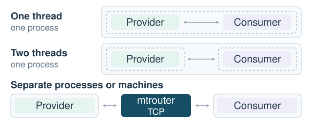
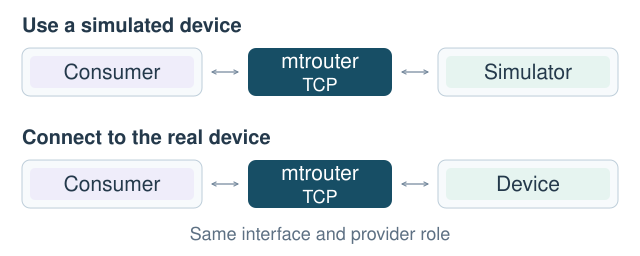
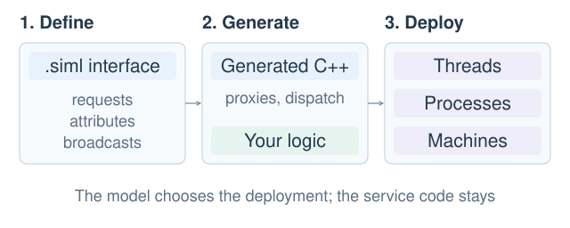
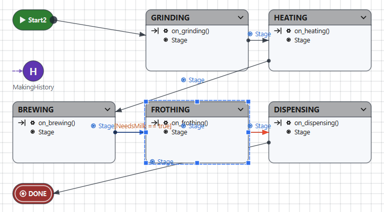
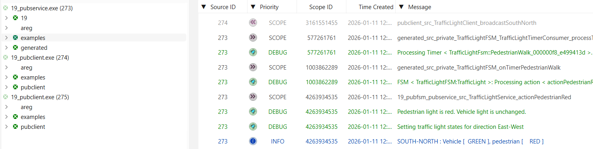

<a id="top"></a>

<div align="center">
  <a href="https://www.areg.tech">
    
  </a>
</div>

# C++ multithreading, IPC and distributed services

**C++ services that don't care where they run.** Write a service once; run it in a thread, in a process or on another machine.
The service code stays, the application model decides.

[](https://github.com/aregtech/areg-sdk/actions/workflows/cmake.yml)
[](https://codecov.io/gh/aregtech/areg-sdk)
[](https://github.com/aregtech/areg-sdk/releases)
[](./LICENSE.txt)

C++17 · Linux · macOS · Windows · embedded Linux

**[Run it in 2 minutes](#quick-start)** · [Measure your machine](#measure-your-machine) · [Let an AI agent build an app](#agentic-coding)

<div align="center"><a href="./docs/wiki/03-helloservice-walkthrough.md"></a></div>

<div align="center">

| **~9.9 µs** | **~6 GB/s** | **288 KB** | **28 of 28** |
|:---:|:---:|:---:|:---:|
| one-way latency, P50 | sustained throughput | code of a static service on ARMv7 | AI-agent runs passed every hidden test (gRPC: 12 of 15) |

<sub>Latency and throughput: full API call over TCP loopback, laptop Core i7, Linux; 204-byte messages for latency, ~3 MB for throughput.
[Performance](#performance) · [Embedded ready](#embedded-ready) · [Agentic coding](#agentic-coding)</sub>

</div>

The hard part of a C++ system is rarely the algorithm. It is the **threads**, the **IPC** and the **integration code**.
Areg takes that work off your hands.

Describe a service interface once. The code generator writes the proxies, serialization and dispatch; the framework finds services
and runs every call in the thread that owns the component. You write the logic.

**The code you write.** No socket, no address, no lock:

```cpp
// Consumer: send the request once the provider is connected, wherever it runs
request_hello_service(role_name());

// Provider: answer the request
void ServiceComponent::request_hello_service(const areg::String & client)
{
    std::cout << "'Hello Service!' from " << client << std::endl;
    response_hello_service(true);
}

// Consumer: receive the answer, asynchronously
void ClientComponent::response_hello_service(bool success)
{
    std::cout << (success ? "Succeeded" : "Failed") << " to output message." << std::endl;
}
```

**You decide where it runs.** Two threads in one process, from [`03_helloservice`](./examples/03_helloservice/twothreads/src/main.cpp):

```cpp
areg::Model model("ServiceModel");
model.add_thread("Thread1")
     .add_component<ServiceComponent>("ServiceComponent")
     .add_supported_service(HelloService::ServiceName, HelloService::InterfaceVersion);
model.add_thread("Thread2")
     .add_component<ClientComponent>("ServiceClient")
     .add_dependency_service("ServiceComponent");
```

**Move it, don't rewrite it.** Put both components in one thread, or each in its own process
or machine behind `mtrouter`, the multi-target message router: the two classes above do not change.

For C++ on devices, desktops and servers in private networks. Not for web services or public internet endpoints.

**Three things to try, each a few commands:**

| [Run it](#quick-start) | [Measure your machine](#measure-your-machine) | [Let an AI agent build an app](#agentic-coding) |
|---|---|---|
| One provider and one consumer in one thread, two threads and two processes. Same classes, three deployments. | How fast is your PC? Latency in microseconds and throughput in GB/s, from two short benchmarks. | Twelve ready prompts, scored by hidden tests the agent never sees. The dry run costs nothing. |

## Quick start[](#quick-start)

Build [`03_helloservice`](./examples/03_helloservice/): one provider and one consumer, compiled into three deployments.
You need Git, a C++17 compiler, CMake 3.20+ and Java 17+ ([details](#getting-started)).

```bash
git clone https://github.com/aregtech/areg-sdk.git && cd areg-sdk
cmake -B build -DAREG_OUTPUT_LAYOUT=OFF
cmake --build build --config Release -j --target 03_onethread 03_twothreads 03_pubservice 03_pubclient mtrouter
```

**1. One process.** Run the one-thread and the two-thread deployment:

```bash
./build/bin/03_onethread.elf
./build/bin/03_twothreads.elf
```

Both print the same round trip:

```text
'Hello Service!' from ServiceClient
Succeeded to output message.
```

**2. Two processes.** Same classes, now through the router:

```bash
./build/bin/mtrouter.elf        # the router, in the background
./build/bin/03_pubservice.elf   # the provider
./build/bin/03_pubclient.elf    # the consumer
```

The greeting crosses the process boundary. Start the provider and the consumer in any order; on Windows, use one terminal
for each of the three programs. For two machines, set the router address in `areg.init`. Binaries end in `.elf` on Linux, `.mac` on macOS and `.exe` on Windows.

**3. See what changed.** Only the model:
[one thread](./examples/03_helloservice/onethread/src/main.cpp) ·
[two threads](./examples/03_helloservice/twothreads/src/main.cpp) ·
[two processes](./examples/03_helloservice/multiprocess/) ·
[the shared classes](./examples/03_helloservice/common/src/) ·
[step-by-step walkthrough](./docs/wiki/03-helloservice-walkthrough.md)

**What next?**
[Measure your machine](#measure-your-machine) ·
[let an AI agent build an application](#agentic-coding) ·
[start your own project](#getting-started)

**Not using it today?** ⭐ Star Areg to keep it in your C++ toolbox and help other developers find it.

## Table of Contents[](#table-of-contents)

**Start here**

- [Quick start](#quick-start)
- [Use cases](#use-cases)
- [Why Areg](#why-areg)
- [How it works](#how-it-works)

**Evaluate**

- [Performance](#performance)
- [Agentic coding](#agentic-coding)
- [Embedded ready](#embedded-ready)
- [Areg vs. alternatives](#areg-vs-alternatives)

**Build and reference**

- [Getting started](#getting-started)
- [Tools](#tools)
- [Project status and roadmap](#project-status)
- [License and community](#license)

## Use cases[](#use-cases)

**Patterns you can picture in your own system.** Click a diagram to open it full size.

<a id="move-the-processing-stage-not-its-implementation"></a>
<a id="give-a-device-a-typed-api"></a>
<a id="iot-mist-to-cloud--nebula"></a>

<table>
  <tr>
    <td width="50%" valign="top">
      <a href="./docs/img/areg-nebula.svg"></a><br/>
      <b>IoT to Cloud (Nebula).</b> Devices expose typed services, an edge application decides locally and sends only results upstream. Areg runs on every node of the trusted network; the cloud link and its security are the application's. <a href="./docs/USECASES.md#device-as-a-service-driverless-hardware">Device services</a> · <a href="./docs/img/mist-network.png">original illustration</a>
    </td>
    <td width="50%" valign="top">
      <a href="./docs/img/areg-pipeline-deployments.svg"></a><br/>
      <b>Imaging and inference pipelines.</b> A camera collects, a service analyzes, a service stores. Start in one process; give a stage its own process or machine later, without touching its class. <a href="./docs/USECASES.md#scientific-and-industrial-imaging-pipelines">Imaging</a> · <a href="./docs/USECASES.md#edge-ai-and-inference-pipelines">edge AI</a>
    </td>
  </tr>
  <tr>
    <td width="50%" valign="top">
      <a href="./docs/img/areg-device-simulation.svg"></a><br/>
      <b>Software before hardware.</b> Register a simulation under the role name the consumer expects; develop and test before the device exists, then swap in the real provider. <a href="./docs/USECASES.md#simulation-and-hardware-in-the-loop-testing">Simulation and hardware-in-the-loop</a>
    </td>
    <td width="50%" valign="top">
      <a href="./docs/img/areg-multi-ui.svg"></a><br/>
      <b>Many frontends, one backend.</b> Operator UI, monitoring and test tools consume the same service: requests for commands, subscribed attributes for state, no protocol per frontend. <a href="./docs/USECASES.md#multi-display-and-multi-ui-architectures">Multi-UI architectures</a>
    </td>
  </tr>
</table>

Also: [industrial automation and robotics](./docs/USECASES.md#industrial-automation-and-robotics) ·
[digital twins](./docs/USECASES.md#digital-twins-and-real-time-monitoring) ·
[decomposing a C++ monolith](./docs/USECASES.md#incremental-decomposition-of-c-monoliths) ·
[process-based plugins](./docs/USECASES.md#plugin-and-extension-architectures) ·
[all use cases](./docs/USECASES.md)

<div align="right"><a href="#table-of-contents">Contents</a> · <a href="#top">Back to top ↑</a></div>

## Why Areg[](#why-areg)

- **Less infrastructure code** to write and maintain in every project *([estimated time savings](./docs/wiki/08d-areg-framework-rankings.md#10-development-time-savings-with-areg-sdk))*.
- **No locks for a component's own state:** every call runs in the thread that owns the component.
- **No startup-order logic:** start the processes in any order, with no retry loops.
- **Recovery built in:** the watchdog restarts a stuck component thread; consumers are notified when a service disappears and reconnect when it returns.
- **Debug many processes as one:** `logcollector` gathers the logs of every thread, process and device; [Lusan](./docs/wiki/06f-lusan-live-logging.md) shows them live in one view and changes log priorities in the running applications, with no restart.
- **Test before hardware exists:** register a simulation under the same service name and the rest of the system never notices. No conditional compilation, no mock frameworks.

<div align="right"><a href="#table-of-contents">Contents</a> · <a href="#top">Back to top ↑</a></div>

## How it works[](#how-it-works)

**Three steps: define the interface, generate the code, choose the deployment.**

<div align="center"></div>

**1. Define.** A service offers **requests** with their responses, **attributes** (data whose every change reaches the consumers that subscribe)
and **broadcasts** (events with parameters). The interface is a `.siml` document, designed in [Lusan](https://github.com/aregtech/areg-sdk-tools)
or edited as XML. This is the request of the example above:

```xml
<Method ID="2" Name="hello_service" MethodType="Request" Response="hello_service">
    <ParamList><Parameter ID="51" Name="client" DataType="String"/></ParamList>
</Method>
```

**2. Generate.** One CMake line runs the generator and links the result. You derive from the generated provider and consumer bases:

```cmake
addServiceInterface(MyServiceLib ./services/MyService.siml)
```

**3. Deploy.** The model names the threads, the components and their dependencies. Inside a process, calls are dispatched
between threads; across processes and machines the interface is `Public`, and `mtrouter` carries the calls over TCP.

Details: [Service interface guide](./docs/wiki/06e-lusan-service-interface.md) · [Code generator](./docs/wiki/06b-code-generator.md) ·
[What changes between deployments](./docs/wiki/03-helloservice-walkthrough.md#what-changes).

<div align="right"><a href="#table-of-contents">Contents</a> · <a href="#top">Back to top ↑</a></div>

## Performance[](#performance)

**Microsecond latency and gigabytes per second, with the full stack on a laptop.**

Measured on **mobile-class consumer hardware** with the full stack active: serialization, event dispatching and multithreading.
These are not raw socket numbers. Raw data is published: [latency dataset](./docs/wiki/areg-latency-benchmark-20260705.csv).

<a id="latency-tcp-localhost-full-stack-204-byte-messages"></a>
**Latency:** TCP `localhost`, full API call, 204-byte messages. OWT = one-way (2 hops); RTT = round trip through `mtrouter` (4 hops).

| Platform       | CPU               | OWT Min    | OWT P50     | RTT Min     | RTT P50      |
|----------------|-------------------|------------|-------------|-------------|--------------|
| Linux Ubuntu   | i7-13700H (DDR4)  | **9.6 µs** | **~9.9 µs** | **19.1 µs** | **~19.5 µs** |
| macOS          | M3 Pro (LPDDR5)   | 21.6 µs    | 31.4 µs     | 46.0 µs     | 62.5 µs      |
| Windows 11     | i7-13700H (DDR4)  | 32.5 µs    | 40.3 µs     | 64.0 µs     | 82.5 µs      |

<a id="throughput-tcp-localhost-11-measured-at-mtrouter"></a>
**Throughput:** TCP `localhost`, 1:1, measured at `mtrouter`. Sustained = 5+ min run; peak = best short run.

| Platform       | CPU              | ~3 MB, GB/s                | ~0.5 KB, msg/s            |
|----------------|------------------|----------------------------|---------------------------|
| Linux Ubuntu   | i7-13700H (DDR4) | ~6.0-6.5 sust. / ~8.0 peak | ~2.0M sust. / ~2.5M peak  |
| macOS          | M3 Pro (LPDDR5)  | ~6.7-7.0 sust.             | ~2.5M sust.               |
| Windows 11     | i7-13700H (DDR4) | ~2.2 sust. / ~3.0 peak     | ~1.8M sust. / ~2.5M peak  |

Latency is payload-insensitive up to 4 KB: Min rises 1.0 µs across a 20× size increase. Linux latency is measured with pinned cores,
throughput unpinned: two configurations, not one. For context only (third-party, 2021, different hardware): gRPC C++ sequential
RTT ~116–167 µs over a Unix domain socket ([MPI-HD, F. Werner](https://www.mpi-hd.mpg.de/personalhomes/fwerner/research/2021/09/grpc-for-ipc/)).

**Logging:** a log call takes ~0.3 µs in the application; 150K logs/s reach a log observer over TCP and are saved to SQLite
without loss (Linux in WSL2). [Details](./docs/wiki/04f-logging-performance.md)

<a id="measure-your-machine"></a>
### Measure your machine

How fast is your PC? Build the two benchmarks without logging, then start the router and leave its console visible:

```bash
cmake -B build -DAREG_OUTPUT_LAYOUT=OFF -DAREG_LOGGING=OFF
cmake --build build --config Release -j --target mtrouter 30_pubprovider 30_pubconsumer 23_pubservice 23_pubclient
cd build/bin && ./mtrouter.elf --console                    # terminal 1
```

**Latency**, [`30_publatency`](./examples/30_publatency/): three runs of 20 000 messages, then both programs exit.

```bash
./30_pubprovider.elf -n &                                   # terminal 2
./30_pubconsumer.elf -m=bc64 -c=20000 -w=2000 -s=3          # one-way; -m=pp64 for the round trip
```

Each run prints one line: min, p50, p95, p99 and max in microseconds, and the message rate.

**Throughput**, [`23_pubdatarate`](./examples/23_pubdatarate/): ~3 MB frames; the `mtrouter` console shows the live data rate.

```bash
./23_pubclient.elf                                              # terminal 2
./23_pubservice.elf -w=1024 -h=1024 -l=1024 -t=25 -c=20 -s      # terminal 3: starts at ~2.4 GB/s; raise -c
```

These settings are a starting load, not the limit: raise `-c` step by step. Type `-q` in the provider to stop. Past your machine's ceiling the consumer's memory grows: that point is the result.
More recipes, small messages included, are in each example's guide; [`35_loglatency`](./examples/35_loglatency/) measures logging.

**Share your numbers:** [post them in this discussion](https://github.com/aregtech/areg-sdk/discussions/885), with your CPU, OS and compiler. ARM boards and servers are the most wanted.

📈 [Full data and methodology](./docs/wiki/08b-areg-sdk-performance-benchmarks.md) · [vs ZMQ/NanoMsg/NNG](./docs/wiki/08c-areg-vs-hitachi-benchmark.md) · [Framework rankings](./docs/wiki/08d-areg-framework-rankings.md)

<div align="right"><a href="#table-of-contents">Contents</a> · <a href="#top">Back to top ↑</a></div>

## Agentic coding[](#agentic-coding)

**Areg ships what a coding agent needs to build a working C++ application: the guide, the generators and the checks.**

Coding agents barely know Areg from training, and don't need to. [`AGENTS.md`](./AGENTS.md) routes the agent to the one page its task needs;
it declares services, state machines and data types, generators write the plumbing, a checker rejects invented API names,
and one command builds, runs and proves the application.

**Measured against gRPC**, which every model knows: same task, agent and model, scored by hidden tests the agent never sees
(peer loss, either start order, no busy-wait, repeats).

|                                | Areg                                 | gRPC           |
|--------------------------------|--------------------------------------|----------------|
| runs passing every hidden test | **100% (28 of 28)**                  | 80% (12 of 15) |
| C++ written by hand            | **50-75% less**                      | reference      |
| agent requests                 | **35% fewer**                        | reference      |
| fix cycles per run             | **over 80% fewer**                   | reference      |
| price                          | **same**, with more requirements met | reference      |

<sub>8 tasks in 9 task-and-model pairs, two baselines merged ([Claude Code, Sonnet 5.5](./examples/ai-benchmark/baseline-2026-10-17.md), [Copilot CLI, GPT-5.6 Terra](./examples/ai-benchmark/baseline-2026-10-18.md)).
With Terra, the Areg tasks also required exact output lines and a declared state machine.</sub>

**The guide makes the difference:** without it, the coffee-machine task cost 5x and did not work ([details](./examples/ai-benchmark/README.md#without-the-agent-layer)).

**An AI agent drew this state machine.** Lusan opened it unedited, valid and ready for the generator. Only the layout is rough.

<div align="center"><a href="./docs/img/screenshot-fsm-ai.png"></a></div>

**Try it** with Claude Code, Copilot CLI, Codex or Gemini on [twelve ready prompts](./examples/ai-benchmark/), from a temperature monitor
to a three-program charging station. Each run is cold, isolated and scored by the hidden tests:

```bash
mkdir -p ~/runs && cd ~/runs
/path/to/areg-sdk/examples/ai-benchmark/run-benchmark.sh --task examples/ai-benchmark/prompt-elevator.md --dry-run
```

`--dry-run` stages the run and prints the prompt at no cost; remove it to start the agent on your own account.
Add `--framework grpc` for the same task on gRPC, and apply the method to your own project:
[how the benchmark works](./examples/ai-benchmark/README.md).

**Build your own application:** start your agent in an empty folder, point it to [`AGENTS.md`](./AGENTS.md) and describe what you need
([workflow](./docs/wiki/09a-agentic-coding.md)). **Share your runs**, passed or failed,
[in this discussion](https://github.com/aregtech/areg-sdk/discussions/800); a failed run helps the most.

<div align="right"><a href="#table-of-contents">Contents</a> · <a href="#top">Back to top ↑</a></div>

## Embedded ready[](#embedded-ready)

**Embedded Linux on a 32- or 64-bit CPU** -- ARM64, ARMv7, x86_64 and x86.
If the target runs Linux with sockets and pthreads, Areg runs on it: NXP i.MX, TI AM62/AM335x, Rockchip RK3588, STM32MP1, Raspberry Pi, Intel Atom.

Framework code (`text`), GCC 15.2.0, Release, measured with [`tools/intern/footprint.py`](./tools/intern/footprint.py) -- `x86_64` natively,
ARM64 and ARMv7 cross-compiled with the toolchain files the SDK ships:

| What a device stores                               | x86_64   | ARM64     | ARMv7         |
|----------------------------------------------------|----------|-----------|---------------|
| shared `libareg.so`, stored once for every service | 1.26 MB  | 1.18 MB   | **0.74 MB**   |
| a self-contained service, static, logging off      | 526 KB   | 487 KB    | **288 KB**    |
| a service binary against the shared framework      | 43 KB    | 42 KB     | 26 KB         |
| `mtrouter`                                         | 285 KB   | 255 KB    | 171 KB        |

RAM on `x86_64`: a service holds **5.6 MB** resident, and each client connected to `mtrouter` adds **~7 KB** ([RAM details](./docs/wiki/08e-embedded-ready.md#4-ram-what-a-process-holds)).

**Scope today:** embedded Linux only. Bare metal, RTOS and 16-bit targets are not supported; Zephyr is planned after 2.0.0.

📊 [What "embedded ready" means, tuning, and where the line is](./docs/wiki/08e-embedded-ready.md)

<div align="right"><a href="#table-of-contents">Contents</a> · <a href="#top">Back to top ↑</a></div>

## Areg vs. alternatives[](#areg-vs-alternatives)

|                               | Areg SDK                          | gRPC                              | DDS                       |
|-------------------------------|-----------------------------------|-----------------------------------|---------------------------|
| **Service model**             | requests, attributes, broadcasts  | RPC from `.proto`                 | typed topics              |
| **Generated code**            | proxies, base classes, dispatch   | stubs, service bases              | types, readers, writers   |
| **Threading**                 | calls run in the owning thread    | yours to synchronize              | yours to synchronize      |
| **Discovery**                 | by service name                   | DNS or xDS resolvers              | built in                  |
| **Thread, process, network**  | same classes; the model decides   | same stubs; you pick the channel  | same API                  |
| **Fault recovery**            | watchdog restart, reconnect       | retries, health checks            | liveliness QoS            |
| **Logging and tracing**       | distributed logs, viewer          | OpenTelemetry plugin              | vendor tools              |

**Choose something else when** you need RPC across languages or over the public internet (gRPC), interoperability with DDS systems
and their QoS model (DDS), or only a messaging transport under an architecture of your own (ZeroMQ, NNG:
see the [transport benchmark](./docs/wiki/08c-areg-vs-hitachi-benchmark.md)).
Actor frameworks (CAF, SObjectizer) and Qt queued connections also run calls in the owner's thread;
Areg adds generated interfaces, discovery by name and IPC.

<sub>Sources: gRPC [name resolution](https://grpc.io/docs/guides/custom-name-resolution/) ·
[in-process channel](https://grpc.github.io/grpc/cpp/classgrpc_1_1_server.html) ·
[retry](https://grpc.io/docs/guides/retry/) · [health checking](https://grpc.io/docs/guides/health-checking/) ·
[OpenTelemetry](https://grpc.io/docs/guides/opentelemetry-metrics/); DDS (OpenDDS)
[discovery](https://opendds.readthedocs.io/en/latest-release/devguide/introduction_to_dds.html#discovery-matching-and-association) ·
[QoS](https://opendds.readthedocs.io/en/latest-release/devguide/quality_of_service.html).</sub>

<div align="right"><a href="#table-of-contents">Contents</a> · <a href="#top">Back to top ↑</a></div>

<a id="requirements"></a>
## Getting started[](#getting-started)

| Requirement           | Supported                          | Notes                                                |
|-----------------------|------------------------------------|------------------------------------------------------|
| **C++ standard**      | C++17                              |                                                      |
| **Compilers**         | GCC, Clang, MSVC                   | on Windows also clang-cl, Cygwin GCC and MinGW       |
| **Operating systems** | Linux, macOS, Windows 10+          | embedded Linux included                              |
| **CPU**               | x86, x86_64, ARMv7 (32-bit), ARM64 | ARM64 includes Apple Silicon                         |
| **Build system**      | CMake 3.20+                        | or the Visual Studio 2019+ solution                  |
| **Java**              | 17+                                | build time only: runs the bundled code generator     |
| **Python**            | 3.10+                              | **agentic coding only**; not needed to build or run  |

<sub>CI builds and tests every change on Linux (GCC and Clang on x86_64, GCC on x86 and ARM64;
ARMv7 cross-built), macOS (Clang, Apple Silicon) and Windows (MSVC, clang-cl, Cygwin GCC; Win32 built with MSBuild).</sub>

**Setting up a machine from scratch?** `tools/setup-environment.sh` (`.bat` on Windows) installs the build tools from a menu;
[Build environment](./docs/wiki/01e-build-environment.md) has every step by hand.

<a id="ways-in"></a>
**Your own project, built and running,** with `myapp` as its name, from the folder that holds `areg-sdk`:

```bash
sh areg-sdk/tools/setup-project.sh --name myapp --root myapp --mode local --sdk-root areg-sdk
cd myapp && cmake -B build && cmake --build build -j
./build/bin/myapp.elf
```

`--mode ipc` creates the provider and the consumer as two processes with a `run.sh` that starts them with `mtrouter`;
`--mode pubsub` adds attributes and broadcasts. On Windows: `setup-project.bat`.
[All options](./docs/wiki/02a-quick-project-setup.md) · existing CMake project: [CMake integration](./docs/wiki/02b-cmake-integrate.md) ·
the whole SDK: [CMake](./docs/wiki/01b-cmake-build.md), [Visual Studio](./docs/wiki/01c-msvc-build.md), [WSL](./docs/wiki/01d-wsl-build.md).

<a id="learning-path"></a>
**Learning path.** Three examples show the whole idea:

1. **[01_minimalrpc](./examples/01_minimalrpc/)**: a provider and a consumer in two threads of one process.
2. **[02_minimalipc](./examples/02_minimalipc/)**: the same pair in two processes, through `mtrouter`.
3. **[03_helloservice](./examples/03_helloservice/)**: the same classes in one thread, two threads and two processes; only the model changes.

Then: [16_pubmesh](./examples/16_pubmesh/), a mesh of local and public services discovering each other ·
[33_tempalarm](./examples/33_tempalarm/) and [34_coffeemachine](./examples/34_coffeemachine/), **built by an AI agent**,
with attributes, broadcasts and a generated state machine · [all examples](./examples/README.md).

<a id="documentation"></a>
**Documentation.** The [Wiki](./docs/wiki/README.md) covers building and integration, networking, logging, tools, troubleshooting and benchmarks.
Practical tasks: [HOWTO](./docs/HOWTO.md). Building with a coding agent: [AGENTS.md](./AGENTS.md).

<div align="right"><a href="#table-of-contents">Contents</a> · <a href="#top">Back to top ↑</a></div>

## Tools[](#tools)

| Tool                                                  | What it does                                                                      |
|-------------------------------------------------------|-----------------------------------------------------------------------------------|
| `codegen.jar`                                         | generates the service infrastructure from `.siml` and state machines from `.fsml` |
| `mtrouter`                                            | routes messages between processes and machines                                    |
| `logcollector`                                        | collects logs from many processes, optionally recorded into SQLite                |
| `logobserver`                                         | captures, stores and controls log scopes from the console                         |
| [Lusan](https://github.com/aregtech/areg-sdk-tools)   | GUI for designing service interfaces, live log collection and log analysis        |

<div align="center"><a href="./docs/img/lusan-live-log-gen.png"></a></div>

Libraries: `areg` (core framework), `aregextend` (extended utilities, SQLite wrapper), `areglogger` (log observer API).

<div align="right"><a href="#table-of-contents">Contents</a> · <a href="#top">Back to top ↑</a></div>

<a id="project-status"></a>
## Project status and roadmap[](#project-status)

| | |
|---|---|
| **Build** | [](https://github.com/aregtech/areg-sdk/actions/workflows/cmake.yml) [](https://github.com/aregtech/areg-sdk/actions/workflows/msbuild.yml) [](https://github.com/aregtech/areg-sdk/actions/workflows/platforms.yml) |
| **Quality** | [](https://github.com/aregtech/areg-sdk/actions/workflows/codeql-analysis.yml) [](https://github.com/aregtech/areg-sdk/actions/workflows/sanitizers.yml) [](https://codecov.io/gh/aregtech/areg-sdk) [](https://github.com/aregtech/areg-sdk/actions/workflows/agent-docs.yml) |
| **Release** | [`v2.0.0-rc2`](https://github.com/aregtech/areg-sdk/releases/tag/v2.0.0-rc2), the second 2.0 release candidate. Supported: 2.0.0-rc2 and newer, and `master`. Release 1.5.0 and earlier use a different API and are not supported. |
| **Packages** | Build from source, or let CMake fetch Areg. |
| **Security** | `mtrouter` connections are plain TCP, with no encryption or authentication today: run Areg in trusted networks. |

<a id="roadmap"></a>
**Next:** After the 2.0.0 release and the vcpkg port · RTOS support, starting with Zephyr.
**Planned:** shared memory transport (zero-copy on one machine) · optional TLS for `mtrouter` connections.
**Open for community input:** language bindings (Python, Rust) · WebSocket transport · cloud-native deployment patterns.

<div align="right"><a href="#table-of-contents">Contents</a> · <a href="#top">Back to top ↑</a></div>

<a id="license"></a>
<a id="community"></a>
## License and community[](#license)

Areg SDK is released under the **[Apache License 2.0](./LICENSE.txt)**, a permissive license for open-source and commercial use.
**Commercial support:** enterprise licensing, training and dedicated support. Visit **[areg.tech](https://www.areg.tech/)** or email **info[at]areg[dot]tech**.

[Issues](https://github.com/aregtech/areg-sdk/issues) · [Discussions](https://github.com/aregtech/areg-sdk/discussions) · [Contributing guide](./CONTRIBUTING.md)

**Built something with Areg?** Open a discussion and tell us about it, and add the badge to your project:
[](https://github.com/aregtech/areg-sdk)

**Did the benchmarks run on your machine?** Post your numbers, and leave a ⭐ so the next C++ developer finds Areg.

<div align="right"><a href="#table-of-contents">Contents</a> · <a href="#top">Back to top ↑</a></div>

---

*Areg (Արեգ) – Old Armenian: the Sun.*
