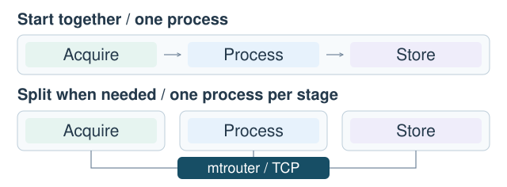
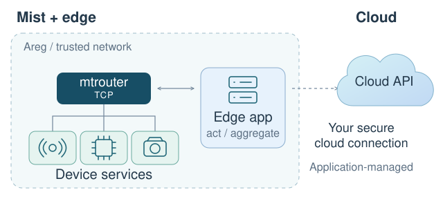
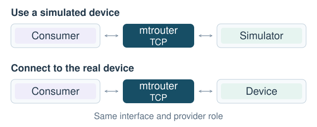
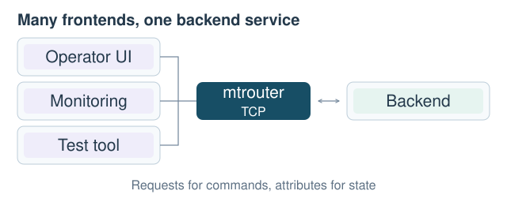

# Use Cases and Benefits

```
This file is part of Areg SDK
Copyright (c) 2021-2026, Aregtech (Artak Avetyan)
Contact: info[at]areg.tech
Website: https://www.areg.tech
```

Areg is useful when C++ components need a stable service interface while their
thread/process deployment evolves. Generated communication, named dependencies and
thread-owned dispatch replace infrastructure the application would otherwise maintain.

The following are **application patterns, not documented customer deployments**.
For executable evidence of deployment reuse, run
[one service implementation in three deployments](./wiki/03-helloservice-walkthrough.md).
The provider and consumer implementations stay shared; the application models and build
arrangement differ. Changing compiled models requires rebuilding.

## Table of Contents

- [Imaging pipelines](#scientific-and-industrial-imaging-pipelines)
- [Device services](#device-as-a-service-driverless-hardware)
- [Industrial automation](#industrial-automation-and-robotics)
- [Edge inference](#edge-ai-and-inference-pipelines)
- [Digital twins and monitoring](#digital-twins-and-real-time-monitoring)
- [Simulation and hardware-in-the-loop](#simulation-and-hardware-in-the-loop-testing)
- [Distributed C++ applications](#distributed-c-applications)
- [Restarting selected components](#live-component-replacement-without-restart)
- [Incremental monolith decomposition](#incremental-decomposition-of-c-monoliths)
- [Runtime configuration](#dynamic-configuration-propagation)
- [Process-based extensions](#plugin-and-extension-architectures)
- [Multiple UIs over one backend](#multi-display-and-multi-ui-architectures)
- [Coordinated shutdown](#coordinated-system-wide-shutdown)
- [Summary and limits](#summary)

## Scientific and Industrial Imaging Pipelines

**Move a processing stage without rewriting its service communication.**
Acquisition, preprocessing, analysis and storage can begin in one application and
later run as separate service processes.

Each stage exposes a typed interface. The application model decides which components
share a thread or process; `mtrouter` carries cross-process messages. Moving a stage
changes its model/build arrangement, not the shared provider and consumer implementations.

<div align="center"><a href="./img/areg-pipeline-deployments.svg"></a></div>

**Where it fits:** scientific instruments, machine vision and industrial inspection.
Measure end-to-end processing capacity, queue growth and acceptable loss on your workload.
Published loopback transport measurements do not establish frame-loss guarantees or
support for every detector. [Benchmark methodology](./wiki/08b-areg-sdk-performance-benchmarks.md).

<a id="device-as-a-service-driverless-hardware"></a>
## Device services

**Give host applications a typed API to a device.**
A device-side application exposes measurements and commands as Areg services.
Host consumers use generated proxies rather than a new host-facing protocol for each application.

This can avoid a custom host kernel driver when the device is reachable through an
existing network stack. It does not remove the device's OS, hardware drivers or
platform integration. It is not a replacement for arbitrary USB or other kernel drivers.

**Where it fits:** laboratory instruments, sensor nodes and embedded controllers.
In the **Nebula / Mist-to-Cloud** pattern, an edge application coordinates device services
inside a trusted network and manages its own secure connection to a cloud API.

<div align="center"><a href="./img/areg-nebula.svg"></a></div>

[Original Nebula concept](./img/mist-network.png).
The illustration is an architecture pattern, not a measured scale or latency guarantee.

## Industrial Automation and Robotics

**Separate equipment behavior from connection management.**
Expose controller and sensor capabilities as services. Consumers declare dependencies
on provider role names and receive connection-state callbacks as services appear or disappear.

A configured watchdog can restart an unresponsive component thread and reinitialize
its components. It does not restart a crashed process, restore lost state or make
equipment safe automatically. The application must define recovery and safe-state behavior.

**Where it fits:** supervisory control, equipment coordination and monitoring on supported
general-purpose operating systems. This is not a claim of hard-real-time behavior,
safety certification or a drop-in replacement for a safety PLC.

## Edge AI and Inference Pipelines

**Separate inference deployment from the surrounding service calls.**
Acquisition, preprocessing and inference can use different processes or machines while
retaining their typed service boundaries.

Model/build changes determine placement; router settings determine connectivity.
Editing `areg.init` alone does not move components between processes.
Areg supplies communication, not GPU scheduling, an inference engine or a model runtime.

**Where it fits:** inspection pipelines and sensor analysis split across edge computers.
Benchmark payload sizes, serialization, network capacity and inference time together;
transport throughput alone does not establish pipeline capacity.

## Digital Twins and Real-Time Monitoring

**Expose real and simulated equipment through the same service contract.**
An application can implement a representation or simulator of a device and publish state
as service attributes. Subscribed consumers receive updates without application polling.

Cross-process communication still uses `mtrouter`, Areg's message intermediary.
This is not broker-free communication, and it does not imply durable messaging,
instantaneous delivery or simultaneous updates across consumers.

**Where it fits:** equipment visualization, monitoring and simulation.
The application defines state freshness, failure detection requirements and how its
representation reconciles with the physical device.

## Simulation and Hardware-in-the-Loop Testing

**Develop and exercise the client before hardware is available.**
Implement the device interface in a simulated provider, using the role name expected
by the consumer. Later deploy the device-backed provider under that same role.

<div align="center"><a href="./img/areg-device-simulation.svg"></a></div>

These are alternative deployments, not two providers competing for one role.
Run locally for iteration, then across processes to exercise the IPC path.
Models, interface visibility and router configuration must match the chosen deployment.

**Where it fits:** embedded development, test rigs and hardware-in-the-loop setups.
The shared contract preserves service calls; simulation fidelity, timing and hardware
validation remain application responsibilities.

## Distributed C++ Applications

**Declare which components belong to an application instead of hand-wiring their dispatch.**
An Areg model describes threads, components, provided services and dependencies.
`areg::Application::load_model()` instantiates that model.

The framework handles the service communication and component lifecycle.
The application still defines business state, error handling, resource ownership and
the shutdown policy for its work.

**Where it fits:** data acquisition, simulation and distributed sensor aggregation.
This is a component architecture to adopt, not a transparent adapter for arbitrary C++ objects.

<a id="live-component-replacement-without-restart"></a>
## Restarting selected components

**Manage a group of components separately from the rest of the application.**
Model load/unload operations provide a boundary for stopping and recreating components.
Consumers can reconnect when their named provider becomes available again.

This is lifecycle control, not automatic hot replacement of compiled code.
Deploying a new binary may require restarting its process. Preserving state, draining
work and coordinating dependents require an application policy; zero downtime is not guaranteed.

**Where it fits:** reinitializing a subsystem or orchestrating service-process restarts.

## Incremental Decomposition of C++ Monoliths

**Introduce a service boundary before extracting a process.**
Adapt one subsystem to a typed service interface and verify it locally.
Then change its model/build arrangement to run it separately through `mtrouter`.

The initial adaptation can require significant work: shared pointers, synchronous calls,
global state and resource ownership do not become distributed automatically.
Once the boundary exists, its service implementations can be reused across deployments.

**Where it fits:** existing C++ systems needing process isolation or independent deployment,
without requiring every subsystem to be extracted at once.

## Dynamic Configuration Propagation

**Publish settings to subscribed components instead of making them poll.**
A configuration service exposes settings as attributes. Consumers subscribe and
handle updates through their service interface.

Delivery is asynchronous, not simultaneous or transactional across the system.
Applications decide which settings can change live, how to validate them and whether
acknowledgements or coordinated activation are needed.

**Where it fits:** runtime parameter tuning and shared configuration across service processes.
This is application configuration, distinct from changing compiled deployment models.

## Plugin and Extension Architectures

**Expose an extension as a service process.**
The host consumes a named service through a generated interface rather than loading
the extension's C++ objects into its own address space.

Starting or stopping the extension uses the usual service connection lifecycle.
Design and evolve compatible interfaces; a version number alone does not make
arbitrary contract changes compatible. Process isolation is not a security sandbox,
and the current router transport is intended for trusted peers.

**Where it fits:** tools and applications that benefit from out-of-process extensions.

## Multi-Display and Multi-UI Architectures

**Let multiple applications share one backend service.**
Operator interfaces, monitoring applications and test tools can consume the same
backend contract. Requests carry commands; subscribed attributes deliver state updates.

<div align="center"><a href="./img/areg-multi-ui.svg"></a></div>

An additional consumer need not introduce another backend protocol.
The application still handles competing commands, permissions, slow consumers and
integration with each UI toolkit's own event loop.

**Where it fits:** industrial HMIs, multi-operator tools and desktop applications with a
separate processing backend. Client count and update rate remain workload-dependent.

## Coordinated System-Wide Shutdown

**Give component teardown a defined lifecycle.**
Use model lifecycle operations to stop the component groups an application owns.
For a distributed shutdown, coordinate the participating applications explicitly.

Do not treat `unload_model()` as a guarantee that every in-flight operation has completed
or that hardware is already safe. Define completion acknowledgements, cancellation,
timeouts and safe-state transitions before teardown where the application needs them.

**Where it fits:** services with long-running operations, persistent data or hardware side effects.

## Summary

<a id="use-cases-and-core-advantages"></a>
<a id="the-common-thread"></a>

The common benefit is **preserving service implementations while changing deployment
boundaries**. Discovery, generated communication and dispatch support that architecture;
they do not remove the application's responsibility for correctness, capacity or recovery.

### Scope and Limitations

Current targets are Linux, macOS and Windows, including embedded Linux with the required
OS facilities. Bare metal and RTOS are not supported today. Cross-process communication
requires `mtrouter` and uses plain TCP without built-in authentication or encryption.
Shared-memory transport and optional TLS are planned, not current capabilities.

[Run the deployment example](./wiki/03-helloservice-walkthrough.md) ·
[Create an application](./wiki/02a-quick-project-setup.md) ·
[All examples](../examples/README.md) ·
[Back to README](../README.md#use-cases)
